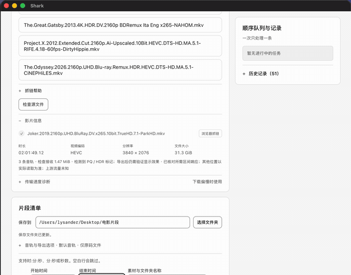

# Shark Clip

> Extract a clip from a video **by time range, on your machine** — download only the bytes you need, and never re-encode the video.

[](https://github.com/Lysander5249/shark-clip/actions/workflows/test.yml)
[](LICENSE)

[中文](README.md) · [Releases](https://github.com/Lysander5249/shark-clip/releases) · [Issues](https://github.com/Lysander5249/shark-clip/issues)

---

## The idea

You have a 40 GB 4K movie and need 15 seconds of it: `01:12:30 – 01:12:45`.

Downloading 40 GB to cut out 15 seconds is absurd. Shark Clip reads the container
index first, works out which byte ranges hold that window, fetches **only those**,
and stream-copies the video — so a typical request pulls tens of megabytes instead
of tens of gigabytes, with zero quality loss.



## Features

- **Range-based extraction** — start/end time, padding, multiple segments
- **No re-encoding** — MKV output copies the video stream as-is
- **Remote sources** — local files, HTTP/HTTPS, WebDAV (incl. CloudDrive2)
- **Matroska cue seeking** — locate keyframes from the index instead of downloading the file
- **Resumable** — interrupted transfers continue from the missing bytes
- **Visible transfer accounting** — the UI shows exactly how many bytes it received
- **Optional MP4 working copy** — keeps the video codec, transcodes audio to AAC stereo
- **Sequential queue**, Chinese UI, **zero runtime dependencies**

## Install

Grab the archive for your platform from [Releases](https://github.com/Lysander5249/shark-clip/releases):

| Platform | File |
|---|---|
| macOS (Apple Silicon) | `Shark-<version>-mac-arm64.zip` |
| Windows x64 | `Shark-<version>-windows-x64-Edge.zip` |

Node.js, FFmpeg and ffprobe are bundled — nothing else to install.

Releases are **not yet notarized / code-signed**, so the OS will warn on first launch:

- **macOS**: right-click the app → **Open** → **Open** again. Or `xattr -dr com.apple.quarantine /Applications/Shark.app`
- **Windows**: on the SmartScreen prompt, click **More info** → **Run anyway**

### From source

Requires Node.js 22+ and `ffmpeg` / `ffprobe` on `PATH`:

```bash
npm start
```

Then open the local URL printed in the terminal.

## Measured

From the regression suite (synthetic HTTP source, not a cloud-drive measurement):

| | |
|---|---|
| Source size | 63.8 MB |
| Window | `104s – 111s` (7 s) |
| Bytes requested from origin | 4.80 MB |
| Bytes actually received | **4.27 MB** |

The tool reports only its own received traffic. Upstream prefetch/cache performed by
CloudDrive2 or the cloud provider is not included — do not read this as a claim about
upstream behaviour.

## What it does not do

- **It is not a downloader.** It will not fetch whole files or create magnet/offline tasks for you.
- **It bypasses nothing.** Cloud-drive support reuses *your own logged-in browser session*; it never touches your credentials.
- **No DRM circumvention**, no paywall bypass, no bundled content sources.
- **No HDR tone mapping.**
- MP4 working copies keep the original video codec (e.g. HEVC); whether your editor imports them is up to the editor.

## Compliance

Use it only on content you have the right to access and use.
Cloud-drive integration depends on your own browser session and a local
CloudDrive2 / WebDAV endpoint. This project is **not affiliated with, endorsed by,
or authorised by Xunlei or Baidu**, whose terms of service may restrict third-party
access. Provided under Apache-2.0, **without warranty of any kind**.

## Development

```bash
node --test --test-concurrency=1 test/*.test.mjs   # 674 cases, ~60 s
npm run test:desktop
```

Fixtures are generated with FFmpeg and need `libx264` (test-only; the shipped FFmpeg is
an LGPL build without libx264). Builds: `npm run build:mac`, `npm run build:windows`.

## License

[Apache License 2.0](LICENSE) © 2026 Shark Clip contributors — see [NOTICE](NOTICE).
