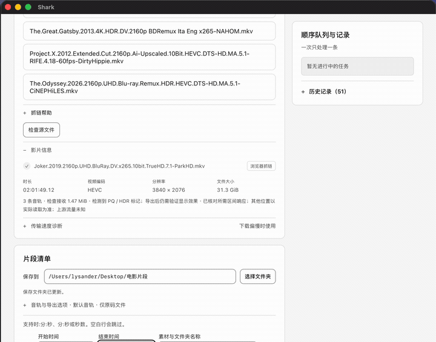

# 片段取材 · Shark Clip

> 在本机按时间范围提取视频片段——**不下载整片，只取你要的那几十秒**，视频不重新编码。

[](https://github.com/Lysander5249/shark-clip/actions/workflows/test.yml)
[](LICENSE)
[](#快速开始)

[English](README.en.md) · [试用说明](docs/trial.md) · [问题反馈](https://github.com/Lysander5249/shark-clip/issues)

---

## 一句话

一支 40 GB 的 4K 电影，你只要 `01:12:30 – 01:12:45` 这 15 秒。
传统做法是把 40 GB 拖下来再切；这个工具只读这一段对应的字节，**通常几十 MB**，而且视频流是原样拷贝出去的，不重新压缩。

<!-- 演示动图：录制后放到 docs/demo.gif，然后取消下面这行的注释 -->
<!--  -->

---

## 为什么做这个

做电影剪辑的时候，我 90% 的时间只需要一支片子里的一两秒画面。但每次都要：

1. 等整片下载完（或者开着网盘客户端挂着）
2. 导进剪辑软件，拖到那一帧
3. 发现编码不对，转码，再等半小时

烦的不是剪辑，是**为了 8 秒画面搬运 40 GB**。所以我写了这个工具：告诉它「哪一支片子、哪一段」，它只取那一段。

后来发现身边做二创、做影视解说、做课件的人都有同样的麻烦，就把它整理开源了。

---

## 它能做什么

- **按时间范围取材**：填 `01:12:30 - 01:12:45`，支持前后余量、多片段时间轴
- **不重新编码**：MKV 主本直接复制视频流（stream copy），画质零损失
- **远程源按需读取**：本地文件、HTTP/HTTPS 直链、WebDAV（含 CloudDrive2）、云盘抓链
- **MKV 精确跳转**：解析 Cue 索引定位关键帧，不需要把整片拉下来才能 seek
- **断点续传**：中断后从缺失的字节继续，不重头再来
- **流量可见**：界面上显示这次实际接收了多少字节——**这个数字你能自己核对**
- **可选 MP4 工作副本**：保留视频编码，音频转 AAC 双声道，方便导入剪辑软件
- **顺序队列**：一次排多个片段，做完一个自动下一个
- **中文界面**，零运行时依赖（纯 Node 内置模块）

---

## 快速开始

### 方式一：下载安装包

到 [Releases](https://github.com/Lysander5249/shark-clip/releases) 下载对应平台：

| 平台 | 文件 | 说明 |
|---|---|---|
| macOS（Apple Silicon） | `Shark-<版本>-mac-arm64.zip` | 解压后拖动 `Shark-mac-arm64.app` 到「应用程序」 |
| Windows x64 | `Shark-<版本>-windows-x64-Edge-*.zip` | 完整解压后运行 `Shark.exe` 或 `启动片段取材.cmd` |

安装包内已含 Node.js、FFmpeg 和 ffprobe，**不需要另外安装任何东西**。
每个 Release 都附带 `.sha256` 校验文件，下载后可自行核对。

> ⚠️ 当前版本**未做 Apple 公证 / Windows 代码签名**，所以首次打开会被系统拦一下。看下面两节，一次点击的事。

### macOS：首次打开被拦怎么办

系统会提示「无法验证开发者」或「已损坏」。**不要关掉系统安全保护**，用下面任一方式：

1. 在「访达」里**右键点击** App → 选「打开」→ 弹窗里再点「打开」
2. 或到「系统设置 → 隐私与安全性」，页面下方点「仍要打开」
3. 或命令行（把路径换成你的）：

```bash
xattr -dr com.apple.quarantine /Applications/Shark.app
```

### Windows：SmartScreen 拦了怎么办

弹出「Windows 已保护你的电脑」时，点「**更多信息**」→「**仍要运行**」。只需要一次。

### 方式二：从源码运行（任何平台）

需要 Node.js 22+，以及 PATH 里的 `ffmpeg` / `ffprobe`：

```bash
npm start
```

终端会打印一个本机地址（形如 `http://127.0.0.1:51234`），用浏览器打开即可。
源码方式完全没有 Gatekeeper 问题。

---

## 实测：到底省了多少

仓库里的回归测试会跑一个合成源的远程取材，日志会打印真实字节数：

| 指标 | 数值 |
|---|---|
| 源文件总大小 | 63.8 MB |
| 取的时间窗口 | `104s – 111s`（7 秒） |
| 向源站请求的字节 | 4.80 MB |
| 实际接收的字节 | **4.27 MB** |

> 说明：这是**合成测试源**的实验室数据，不是迅雷 / 百度网盘的真实测量，用来验证「区间读取」这条链路确实只读了该读的字节。你自己的云盘实测数字以界面显示为准。

**一个必须说清楚的边界**：本工具只统计自己接收的流量。CloudDrive2 或网盘上游的预取、缓存、下载流量不在统计里，因此**不能**据此推断上游只读了同样大小的片段。

---

## 它是怎么做到的

```
时间范围
   │
   ├─ 本地文件 ──────────────────────────────┐
   │                                          │
   └─ 远程源 ─→ 读 MKV Cue 索引（几 KB）       │
                    │                         │
                    ↓                         │
              定位关键帧的字节偏移              │
                    │                         │
                    ↓                         │
        HTTP Range 只取需要的区间 ────────────┤
                    │                         │
                    ↓                         ↓
              ┌───────────────────────────────┐
              │  FFmpeg stream copy（不转码）  │
              └───────────────────────────────┘
                              │
                              ↓
                      MKV 片段 / MP4 工作副本
```

关键点：**先读索引，再决定读哪些字节**。没有索引的格式会退化为按块探测，能取到，但读的字节会多一些。

---

## 它不做什么

写清楚边界，比列功能更重要：

- **它不是下载器**。不会帮你下载整片，也不会替你创建磁力/离线任务——那件事请用官方客户端。
- **不绕过任何权限**。云盘抓链用的是**你自己浏览器里已登录的会话**，它不碰你的账号密码，也不修改你的网盘。
- **不解 DRM，不破解付费墙**，不提供任何片源。
- **未做 HDR / 杜比视界色调映射**，HDR 素材的观感请在剪辑软件里自行确认。
- **不是所有编码都能直接导入剪映**——MP4 工作副本会保留原视频编码（比如 HEVC），是否支持取决于你的剪辑软件版本。

---

## 合规与免责

- 本工具仅用于处理**你有权访问、有权使用**的内容。用它处理什么，责任在你自己。
- 云盘相关功能依赖你在本机浏览器中的登录状态，以及本机的 CloudDrive2 / WebDAV。本项目**与迅雷、百度网盘无任何关联**，未获其授权或背书。
- 各云盘的服务条款可能限制第三方读取，请在使用前自行确认。工具内置的说明文字已尽量提示这一点。
- 项目按 Apache-2.0 提供，**不附带任何担保**。

---

## 开发

零依赖，克隆下来就能跑：

```bash
node --test --test-concurrency=1 test/*.test.mjs   # 核心回归（674 个用例，约 60 秒）
npm run test:desktop                                # 桌面打包回归
```

测试素材由 FFmpeg 合成生成，需要带 `libx264` 的 FFmpeg（仅测试用；发布包里的 FFmpeg 是 LGPL 构建，不含 libx264）。

**目录结构**

| 目录 | 内容 |
|---|---|
| `server.mjs` | 本机 HTTP 服务与全部 API（只监听 `127.0.0.1`） |
| `src/` | 引擎、远程读取、MKV 索引、续传、WebDAV、云盘适配 |
| `public/` | 前端（原生 ES 模块，无构建步骤） |
| `browser-helper/` | 浏览器扩展（抓链用） |
| `desktop/` | macOS / Windows 桌面外壳 |
| `scripts/` | 可复现构建、打包、烟测 |
| `test/` | 回归测试 |

**构建**

```bash
npm run build:mac       # Apple Silicon
npm run build:windows   # Windows x64
```

构建过程固定 Node.js 与 FFmpeg 版本并校验 SHA256，细节见 [desktop/README.md](desktop/README.md)。

**第三方组件**

随包分发的 FFmpeg 是 **LGPL-2.1-or-later** 构建（`--disable-gpl --disable-version3 --disable-nonfree`，不含 libx264），并附带：

- 完整对应源码与 SHA256
- 实际使用的 `configure` 参数
- 可一键重建的 `rebuild.sh`
- 二进制可替换说明

详见包内 `Licenses/` 目录。

---

## 许可证

[Apache License 2.0](LICENSE) © 2026 Shark Clip contributors

你可以自由使用、修改、分发，包括商用；保留版权声明与许可证即可。详见 [NOTICE](NOTICE)。
